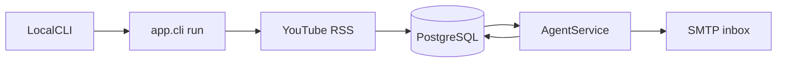

# Daily YouTube Digest

Build a Python pipeline that ingests a curated list of YouTube channels over RSS into local PostgreSQL, then asks DeepSeek for a short linked digest and emails it over SMTP. You run it yourself with a local command; there is no scheduler and no Render cron.

Greenfield build on the existing Python 3.12 stub ([pyproject.toml](../pyproject.toml), [main.py](../main.py)). All logic goes in `app/`. Postgres runs locally from `docker/`. There is no cron job, no in-process scheduler, and no Render deployment. You start a digest by running the CLI when you want one.

DeepSeek is called through the official OpenAI-compatible endpoint (`https://api.deepseek.com`, model `deepseek-chat`) with the `openai` SDK. That call lives in `app/agent/service.py`, which also loads the editable system prompt. Mail goes out with `smtplib` (STARTTLS on port 587).

## Tasks

- Add `app/database` with SQLAlchemy models, session, `migrate.py`, and Alembic. Schema changes are new revisions, not `create_all`.
- Seed `channels.json` and ingest YouTube RSS into articles with video-id dedupe.
- Add `app/agent/service.py` to load the system prompt, call DeepSeek, and reject unknown URLs. `digest/generate.py` only selects the last 24 hours and calls that service.
- Render and send the SMTP digest, persist digest rows, and skip a second send the same UTC day.
- Add docker-compose for local Postgres, `.env.example`, and README steps for a manual local run.

## Flow



Each run expects the schema to already be migrated. It upserts channels, fetches each channel RSS, stores new videos, loads videos published in the last 24 hours, asks the agent service for punchy snippets, emails them, and records the digest so a second run the same UTC day does not send twice.

## Project structure

Application code stays in `app/`. The database container stays in `docker/`. `main.py` only forwards to the CLI.

`app/cli.py` is the command entrypoint for the whole program (`migrate`, `seed`, and `run`). It is not the migration module. Schema code lives in `app/database/`: models, the SQLAlchemy session, and `migrate.py`, which is what `cli.py migrate` calls. Alembic's config and revision files sit in that same folder.

```
.
├── app/
│   ├── __init__.py
│   ├── cli.py                 # commands only: migrate, seed, run [--force]
│   ├── config.py              # env settings
│   ├── pipeline.py            # ingest, then digest, then email
│   ├── database/
│   │   ├── __init__.py
│   │   ├── models.py          # Source, Article, Digest
│   │   ├── session.py         # engine and session
│   │   ├── migrate.py         # upgrade head and revision check
│   │   ├── alembic.ini
│   │   └── alembic/
│   │       ├── env.py         # DATABASE_URL and app.database.models
│   │       ├── script.py.mako
│   │       └── versions/
│   │           └── 0001_initial.py
│   ├── data/
│   │   └── channels.json      # curated YouTube channels
│   ├── agent/
│   │   ├── __init__.py
│   │   ├── service.py         # DeepSeek client and snippet JSON
│   │   └── prompts/
│   │       └── digest_system.md  # editable insights
│   ├── digest/
│   │   ├── __init__.py
│   │   └── generate.py        # last 24 hours, then agent service
│   ├── emailer/
│   │   ├── __init__.py
│   │   └── smtp.py
│   └── ingest/
│       ├── __init__.py
│       └── youtube.py         # channel RSS
├── docker/
│   └── docker-compose.yml     # Postgres 16
├── docs/
│   └── daily-youtube-digest-plan.md
├── .env.example
├── .gitignore
├── .python-version
├── main.py                    # thin entrypoint
├── pyproject.toml
└── README.md
```

## Layout

- [app/config.py](../app/config.py) — env settings. `DATABASE_URL` points at the local Docker Postgres.
- [app/database/models.py](../app/database/models.py) and [app/database/session.py](../app/database/session.py) — SQLAlchemy 2 models and the engine. Tables are created only by Alembic.
- [app/data/channels.json](../app/data/channels.json) — curated `{name, channel_id}` list. Edit this to change sources; the pipeline upserts it every run and marks channels removed from the file as inactive.
- [app/ingest/youtube.py](../app/ingest/youtube.py) — `https://www.youtube.com/feeds/videos.xml?channel_id=...` via `feedparser`. Stores video id, title, URL, description, and `published_at`. Dedupes on video id.
- [app/agent/service.py](../app/agent/service.py) — the agent service. It loads the system prompt, sends the article JSON to DeepSeek, parses the snippet JSON, and drops any URL that was not in the input set.
- [app/agent/prompts/digest_system.md](../app/agent/prompts/digest_system.md) — the agent system prompt. A marked insights section at the top is what you edit (interests, tone, what to skip). Loaded at runtime, overridable with `DIGEST_SYSTEM_PROMPT_PATH`.
- [app/digest/generate.py](../app/digest/generate.py) — selects articles from the last 24 hours and calls `app.agent.service`. It does not talk to DeepSeek itself.
- [app/emailer/smtp.py](../app/emailer/smtp.py) — plain-text plus simple HTML, each snippet with its source link.
- [app/database/migrate.py](../app/database/migrate.py), [app/database/alembic.ini](../app/database/alembic.ini), and [app/database/alembic/](../app/database/alembic/) — migration history. `env.py` imports `app.database.models` and the same `DATABASE_URL` as the app. The first revision creates `sources`, `articles`, and `digests`. Later schema changes are new revisions (`alembic -c app/database/alembic.ini revision --autogenerate -m "..."`), not edits to an already applied file.
- [app/pipeline.py](../app/pipeline.py) and [app/cli.py](../app/cli.py) — `cli.py` only parses commands. `migrate` calls `app.database.migrate` (`alembic upgrade head`). `seed` and `run` are the ingest and digest commands. `run` does not create or alter tables. If the database is not at head, it exits and tells you to migrate. `python main.py` stays a thin call into `app.cli`.
- [docker/docker-compose.yml](../docker/docker-compose.yml) — Postgres 16 only, published on `localhost:5432`.
- [.env.example](../.env.example) and a short [README.md](../README.md) — how to start Postgres and run the pipeline locally. Secrets stay in `.env` (already gitignored).

## Data model

- **sources** — `kind` (`youtube`), name, channel id (unique), feed URL, `active`.
- **articles** — source FK, video id (unique), title, canonical URL, RSS description, `published_at`, `fetched_at`.
- **digests** — UTC window, subject, text and HTML bodies, model name, article count, status (`sent` / `failed` / `empty`), recipient, `sent_at`. Unique on the UTC run date so running the command twice the same day does not mail again. A `--force` flag sends again on purpose.

YouTube RSS returns the latest videos (about 15), not a full archive. Older items are stored, but only `published_at` within the last 24 hours is sent to the model. Descriptions are truncated before the prompt, and the batch is capped (about 40) so a backlog cannot blow the context window. If that window is empty, the job still emails one line that nothing new arrived, and records an `empty` digest.

## DeepSeek contract

The pipeline calls `app.agent.service`. The system message is the contents of `app/agent/prompts/digest_system.md`.

User message: JSON of `{title, source, url, published_at, description}` for the window.

Response JSON only:

- `subject`
- `intro` (one line)
- `snippets[]` with `headline`, `body` (one or two sentences), `url`, `source_name`

`response_format: json_object` on `deepseek-chat`. Snippets whose URL is not in the input set are dropped. The email is rendered in code from that JSON, so the model does not emit HTML.

Default insights in the prompt file: practical AI engineering, tools, and research; short and specific; skip sponsorships and vague hype when the title and description make that obvious. You replace that block with your own.

## Email

`SMTP_HOST`, `SMTP_PORT` (587), `SMTP_USERNAME`, `SMTP_PASSWORD`, `SMTP_FROM`, `SMTP_TO`. For Gmail, the password is an app password and the host is `smtp.gmail.com`. A failed send stores `failed` and exits non-zero. Keys and passwords are never logged.

## How you run it

No scheduler ships with the app. After Postgres is up, apply the schema once, then run a digest whenever you want one:

`python -m app.cli migrate`

`python -m app.cli run`

That command looks at videos published in the last 24 hours, writes the digest, and emails it. Run it again later the same UTC day and it will not send a second email unless you pass `--force`.

## Local check

1. `docker compose -f docker/docker-compose.yml up -d`
2. Copy `.env.example` to `.env` and fill DeepSeek plus SMTP.
3. `uv sync`, then `python -m app.cli migrate`, then `python -m app.cli run`
4. Confirm new rows in `sources`, `articles`, and `digests`, and that the inbox message has one snippet per video with a working YouTube link.
